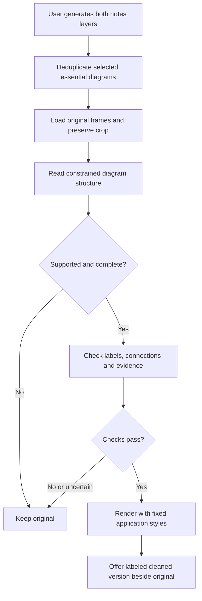

# Automatic diagram cleanup for cited study notes

Research date: 2026-09-21. Status: architecture recommendation, not implemented or accuracy-validated. No paid model calls were made for this research.

## Recommendation

Automatically prepare a cleaned-up version of essential **supported** diagrams during explicit notes generation. Keep the original crop as the default, with a clearly labeled **AI-recreated diagram** alternative and one-click original/full-frame access. This follows the agreed source-first design while removing a separate generation action for students.

For the first version, use **original frames → constrained diagram JSON → application-owned SVG geometry and typeset labels**. Have AI read the diagram; let deterministic code style it. Compare this approach against one image-editing baseline in a small pilot before making a provider or fidelity claim. Do not build a universal diagram editor or promise that every essential diagram can be recreated.

This is an engineering recommendation based on the sources below and current Chalkboard code, not a demonstrated superiority result. A structured representation makes errors inspectable; it does not eliminate visual extraction errors.

## What is already present

Inspected branch `codex/cited-notes`, including its two-layer notes generation:

- `pipeline/src/extraction/study_notes.py`: explicit `generate_notes` job, Comprehensive and Condensed outputs, validation against original source IDs, shared immutable snapshots and usage accounting.
- `pipeline/src/extraction/notes_illustrations.py`: deduplicated diagram/chart selections across both layers; up to three original frames within the artifact interval; Gemini crop selection; validated coordinates; original JPEG hashes, dimensions and timestamps; local/R2 publishing; optional-image failure fallback.
- `viewer/components/notes/StudyNotes.tsx`: shared source renderer, SVG crop, 10% width/height expansion, full-frame access, descriptions and citation controls.
- `viewer/lib/notes-types.ts`: original evidence and illustration metadata; no recreated diagram schema yet. React and KaTeX already exist; Mermaid and Graphviz are not viewer dependencies.

The seam is immediately after original-frame selection in `enrich_illustrations`. Keep one notes-generation flow and one source renderer. No vector database, new agent framework, queue service or general drawing language is needed.

## Approaches compared

| Approach | Benefit | Limitation | First-version decision |
| --- | --- | --- | --- |
| Original image with restrained presentation cleanup | Lowest reconstruction risk; cheap | Cannot recover unreadable or occluded symbols; aggressive contrast/thresholding can erase marks | Always retain as fallback |
| Image-to-image cleanup | Smallest provider integration; flexible appearance | Labels, arrows and topology remain pixels; requires reading the result again to detect changes | Pilot baseline, not assumed reliable |
| Constrained JSON + deterministic rendering | Inspectable labels/edges; predictable typography; reusable accessibility text | Still depends on correct extraction; supported vocabulary must be narrow | Recommended for trees, simple flowcharts and node-link schematics |
| Model-generated SVG/Mermaid/TikZ/code | Broad expressive power | Adds arbitrary syntax, renderer/security surface and hard-to-check geometric changes | Do not accept unrestricted model code |

Gemini supports schema-constrained text output, suitable for a finite diagram representation. That is a format capability, not evidence that a graph extracted from a frame is correct. [Google structured outputs](https://ai.google.dev/gemini-api/docs/structured-output)

Graphviz can render directed graph descriptions to SVG, and Mermaid supplies flowchart syntax and strict security settings. They are reasonable later layout tools for genuinely graph-like content, but neither proves correspondence to an original image. Automatic graph layout should not be applied indiscriminately to spatial STEM diagrams. [Graphviz DOT](https://graphviz.org/doc/info/lang.html), [Graphviz SVG output](https://graphviz.org/docs/outputs/svg/), [Mermaid security settings](https://mermaid.js.org/config/schema-docs/config.html#securitylevel)

## Scope and input contract

“Essential” initially means a diagram already selected as a teaching artifact by either notes layer. Deduplicate by source ID; reuse the same cleaned candidate in both layers. Do not process every visible board artifact. Selection for inclusion and eligibility for reconstruction are separate decisions.

Start with trees, simple flowcharts, labeled boxes/circles and explicit arrows. Preserve node identity, direction, grouping and relative placement. Include containment and repeated groups explicitly: the vEB triangle decomposition and Y-fast trie groups cannot be faithfully represented by a flat list of edges alone.

Keep quantitative plots, geometry proofs, circuits, chemical structures, dense notation, diagrams with ambiguous connections, and partially occluded images as originals until there is a tested representation for them. A curve's shape or a spatial angle can carry meaning; it is not decorative styling. Charts should eventually be recreated from verified values/axes, not invented data inferred from appearance.

Each reconstruction request receives only the selected original frame(s) from that artifact, its crop coordinates, and its locator description. The description identifies the target but is not authoritative over the pixels. Do not provide generated notes as factual context, search the web, invent missing parts, or merge snapshots from different stages into an apparently original diagram. Preserve which frame supports each observation. Request image resolution sufficient to read labels; raising media resolution consumes more tokens. [Google image understanding](https://ai.google.dev/gemini-api/docs/image-understanding)

## Proposed flow

One small module, conceptually `prepare_diagram(original_frames, crop, locator)`, returns either an eligible candidate plus check results or a fallback reason. Its callers do not need to know the internal prompts, schema checks or styles. The existing job owns cancellation, persistence and usage aggregation.

1. **Read:** one multimodal structured-output request produces a finite representation: diagram kind, shapes/nodes, verbatim text or LaTeX labels, directed/undirected connections, grouping, normalized locations, evidence regions, and unresolved items. Unsupported or incomplete is an explicit valid response. No arbitrary paths, URLs, HTML, CSS or executable code from the model.
2. **Validate:** Pydantic rejects extra fields, duplicate IDs, nonexistent endpoints, invalid bounds, excessive element counts and unsupported primitives. Preserve distinctions such as `<` versus `≤`, subscripts, arrowheads and edge labels. A KaTeX parse check establishes renderability only.
3. **Check source fidelity:** a separate vision request compares the original frames with the proposed representation and reports missing/extra labels, changed mathematical symbols, wrong connections, lost containment and unreadable regions. Require explicit per-category results, not a scalar confidence score. Treat mismatches and uncertainty as fallback. Separate request context reduces anchoring; it does not make model errors statistically independent or make the output human-verified.
4. **Render:** application-owned React/SVG primitives set strokes, spacing, fonts and neutral colors. Preserve source-relative arrangement initially. Reuse KaTeX for mathematical labels through controlled React markup; do not pretend KaTeX directly exports SVG. Measure label bounds and handle overlap/clipping with bounded layout rules, not indefinite model retries. Unsupported math/layout fails back to the original.
5. **Present:** show the cleaned candidate as an alternative, labeled “AI-recreated diagram.” Original evidence remains the citation destination. Include a text description and connection/grouping list for accessibility; a bitmap or attractive SVG alone is not an accessible equivalent.

For a raster-editing pilot, the fidelity checker must inspect **the final edited pixels**, not merely the edit prompt. For the structured route, checking the representation is supplemented by rendered-browser tests for label clipping and connection placement. A rendered-image comparison on the pilot catches renderer failures that JSON checks cannot see. Add per-diagram rendered-image checking only if pilot results justify the runtime and deployment cost.

KaTeX exposes error handling, untrusted-input controls, expansion limits and HTML+MathML output. Keep `trust: false`, bounded sizes/expansions, and application-owned markup. [KaTeX options](https://katex.org/docs/options.html)

## Storage, retries and failure behavior

Extend each shared source's `illustration` with an optional `recreated` result. Keep the current `frame` and original `box_2d` untouched. Proposed stored information:

- Result state: `ready`, `unsupported`, `rejected`, or `failed`; omit the field for older notes.
- Source frame hashes, selected frame IDs/times, original crop, and padding-policy version.
- Validated diagram representation and its schema version.
- Requested/resolved model IDs, prompt/check/renderer versions and per-stage token usage.
- Check findings and reason for fallback; never label automated checks as human verification.

Use a content-derived cache key covering the frame bytes, crop/padding, target identity, schema, prompts, models and renderer version. Deduplicate across both notes layers. Failed attempts should not become permanent successes; retries are explicit and bounded. Preserve a useful original/previous candidate if a new attempt fails.

Use the current worker and storage. Put this in the optional illustration stage; catch per-diagram provider/render failures and finish the notes with original evidence. Set a per-job time/call/spend ceiling before starting paid requests, record all incurred usage, and stop on cancellation. Start with one extraction and one checking attempt per eligible diagram, no recursive self-repair loop. For broad lectures, stop at the budget and retain originals for remaining diagrams. A separate asynchronous enhancement queue can come later if measured notes latency becomes unacceptable.

Do not execute model-supplied SVG/HTML/JavaScript, DOT directives or shell commands. SVG used as an `` has more restricted execution behavior than SVG opened directly or embedded as a document; this distinction is not a substitute for generating markup from trusted templates. [MDN SVG image restrictions](https://developer.mozilla.org/en-US/docs/Web/SVG/Guides/SVG_as_an_image)

## Pilot and decision criteria

Use the three existing algorithm diagrams as an integration smoke test, then a held-out set of roughly 30 varied lecture diagrams, including intentionally unsupported and ambiguous examples. Do not treat the three friendly examples as a quality benchmark.

Compare original crops, a conservative image-edit prompt, and the constrained-rendering route. Human-reference labels should cover exact symbols/text, edges and directions, containment, and meaningful relative position. Evaluate:

- Critical semantic changes among candidates the automatic gate accepts.
- Missing/extra labels and connections, and equation-symbol fidelity.
- Whether deliberately corrupted examples are rejected by the checker.
- Readability improvement, including small-screen and screen-reader use.
- Fallback rate, usable-diagram coverage, latency, cost per attempt and cost per accepted result.

Do not optimize aesthetics alone. A recent chart-generation paper explicitly evaluates mathematical logic, text accuracy, text layout and readability separately, supporting this multidimensional evaluation approach; its chart benchmark does not establish accuracy on our lecture diagrams. [ArtChart paper](https://arxiv.org/abs/2607.16060)

Pilot release criterion: no critical semantic change among accepted held-out examples, measurable readability improvement, correct fallback on adversarial cases, and acceptable measured cost/latency. Zero observed errors in a small sample does not prove a low population error rate. Keep the original default until evaluation supports a broader change.

## What this research settles

Automatic preparation of faithful-looking alternatives is feasible using existing multimodal and rendering building blocks. It is not a solved guarantee of semantic fidelity. My recommendation is a narrow constrained-rendering pilot, with image editing as the baseline, and original crops always retained. This makes errors easier to inspect and recover from; it does not establish a legal-liability conclusion.

See [provider research](diagram-beautification-provider-research.md) for current image-model IDs, capability restrictions, documented limitations and pricing. This report proposes architecture only: no implementation, dependency installation, deployment or paid model evaluation was performed.
