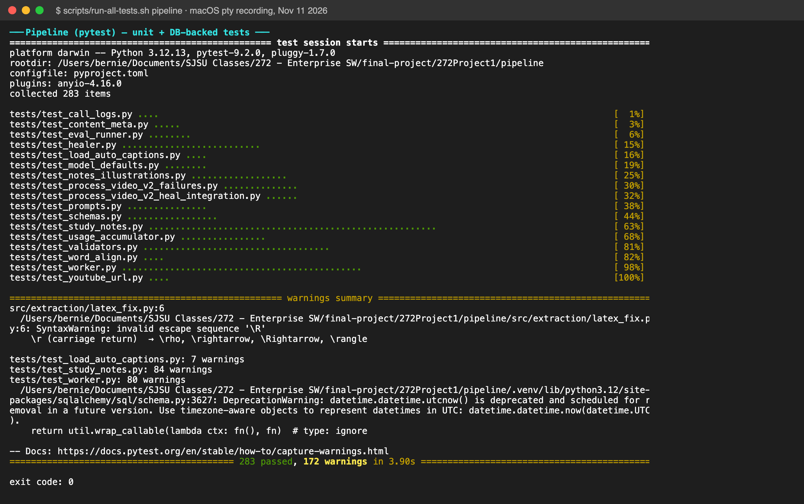
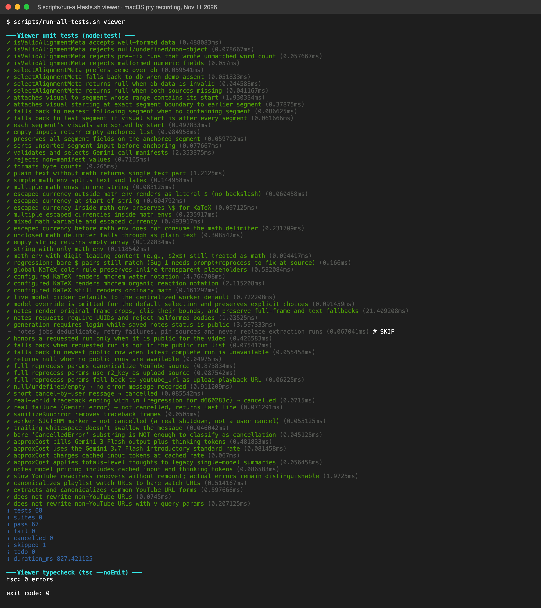
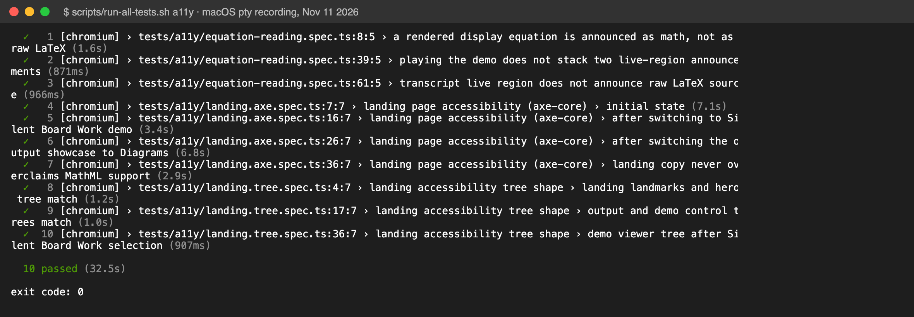

# Test evidence

All suites were run on **November 11, 2026** on macOS 27.2 (Apple Silicon) against a fresh clone of this repository, following the root README: `docker compose up -d db` for the test database, Python 3.12.13, Node 24.6.0, Docker Compose 5.1.0.

| Suite | Command | Result |
|---|---|---|
| Pipeline — unit + DB-backed | `scripts/run-all-tests.sh pipeline` | **283 passed**, 0 failed (224 unit + 59 against the `chalkboard_test` PostgreSQL database) |
| Viewer — unit | `scripts/run-all-tests.sh viewer` | **67 passed**, 0 failed, 1 skipped (68 tests) |
| Viewer — typecheck | (same) | `tsc --noEmit`: 0 errors |
| Accessibility — axe-core + virtual screen reader | `scripts/run-all-tests.sh a11y` | **10 passed**, 0 failed |
| Full stack smoke test | `docker compose -f docker-compose.railway.yml up --build` | db healthy, migrations applied, `GET /api/health` → `{"ok":true,"db":"connected"}`, worker polling |

## Screenshots

| Pipeline | Viewer | Accessibility |
|---|---|---|
|  |  |  |

How they were made: each suite was run through macOS `script(1)`, which records a real pseudo-terminal session byte-for-byte (`raw/*.typescript`). The recordings were then drawn with [xterm.js](https://xtermjs.org/), the terminal emulator used by VS Code, to produce the PNGs. Plain-text logs are in `logs/`.

## Fixes made while producing this evidence

Running the suites from a clean clone surfaced three problems, all fixed in this repository:

1. **Fresh builds could not migrate the database.** `sqlalchemy>=2.0,<3.0` resolved to 2.1, which maps `postgresql://` URLs to the psycopg 3 driver, but the project depends on psycopg2 (the worker relies on psycopg2's tuple expansion in `IN` clauses). The `migrate` container failed with `ModuleNotFoundError: No module named 'psycopg'`. Fix: pin `sqlalchemy>=2.0,<2.1` in `pipeline/pyproject.toml`.
2. **Stale accessibility tests.** Two specs targeted landing-page elements removed in a redesign (a "Spec sheet" tab and a "MathML output" badge). Rewritten against the current page, the axe scan then found a real **WCAG AA color-contrast violation**: the "DIAGRAM" label was 4.33:1 against its background, below the 4.5:1 required for small text. Fixed by darkening the label to `#2a7038` (5.15:1) in `components/landing/TabbedProof.tsx`.
3. **Flaky parallel accessibility runs.** The specs share one dev server and assert on a playing demo video, so parallel workers made them timing-dependent. `playwright.config.ts` now runs them serially (≈35 s total).

The DB-backed tests need the `chalkboard_test` database, which both compose files now create on first start (`scripts/db/init-test-db.sql`).
